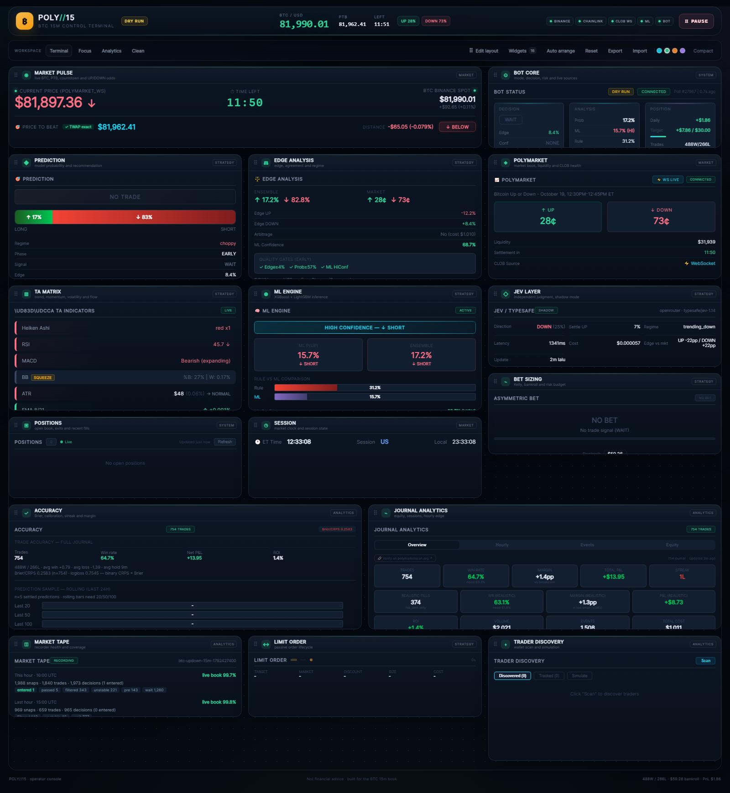

# Dashboard v4 — full UI/UX rework

## Goal

Replace the fixed two-column dashboard with a customizable terminal workspace where every panel is a draggable, resizable widget.

## Shipped

- New shell: sticky top command bar (brand, live price/PTB/countdown, UP/DOWN odds, feed health, bot pause/resume).
- New workspace toolbar: Terminal / Focus / Analytics / Clean presets, edit mode, widget library, auto-arrange, reset, export/import layout, accent themes, density.
- Every panel is now a widget with a drag handle and a bottom-right resize handle.
- Collision-safe placement: a widget dropped on an occupied cell is rejected with a toast instead of teleporting to the bottom.
- Layout persists in `localStorage` (`btc15.dashboard.layout.v4`) and survives a reload. Hidden widgets also persist.
- Widget library drawer: toggle any of the 16 panels on/off; hidden widgets keep their position.
- Presets: 16 / 8 / 8 / 5 widgets for Terminal, Focus, Analytics and Clean.
- Theme dots: cyan, mint, ember, violet (applies to the shell and widgets). Comfortable / compact density.
- Responsive: below 980 px the canvas becomes a single-column stack; Current Price and Bot Core grids collapse to one column below 620 px (no horizontal overflow).
- Legacy panel styling is scoped over the new card skin so existing data components keep working without a data-layer rewrite.

## Files

- `src/components/dashboard/DashboardShell.tsx` — shell, drag/resize, persistence, library, presets, export/import.
- `src/components/dashboard/layout.ts` — pure grid math (packing, overlap, clamping, free-slot search).
- `src/components/dashboard/__tests__/layout.test.ts` — 5 tests.
- `src/styles/dashboard.css` — new visual system, responsive rules and panel skin overrides.
- `src/App.tsx` — data slices are unchanged; panels are passed as widget content.
- `src/main.tsx` — imports the new theme after the legacy stylesheet.

## Verification

- `npm run typecheck` PASS.
- Full suite: **88 files / 929 tests PASS**.
- `npm run build` PASS (new hashed assets deployed to nginx).
- Browser checks through the public tunnel: 16 widgets, drag, resize, hide, persistence after reload, all presets, theme switch, no page errors.
- Mobile 390×844: `scrollWidth === clientWidth === 390`; no horizontal overflow; price/Bot Core stack correctly.

## Deploy

- New `dist/index.html` and hashed assets uploaded to `/opt/polybtc15/dist`; nginx continues to serve the same public URL.
- Frontend only: bot logic, JEV, ledger and trading are untouched. No restart of the bot.

## Preview

