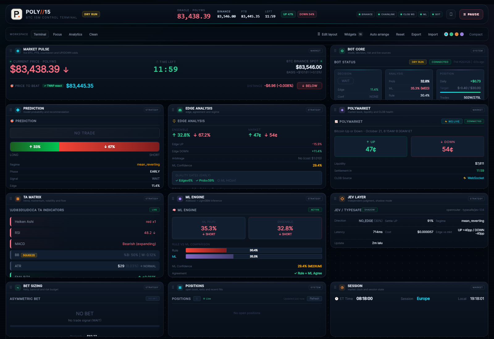
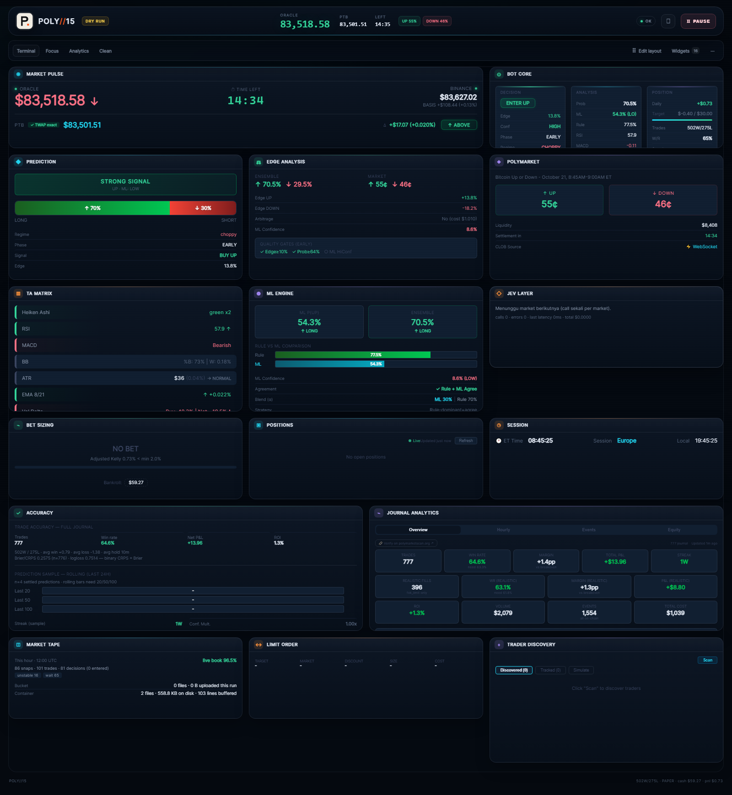
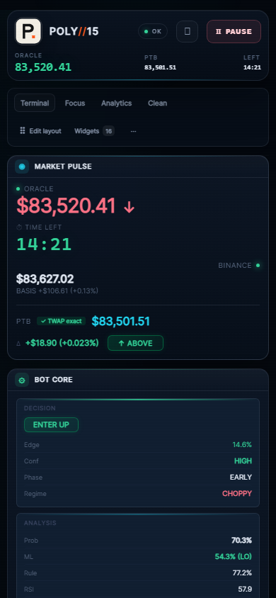

# Clean dashboard redesign — 2026-10-21

## Goal

Make the console look calmer and less text-heavy without removing the data operators need.

## Shell changes

- Topbar: removed the five source pills; one `OK/CHECK` health dot with a tooltip. Removed the secondary Binance value from the topbar (it remains in Market Pulse). Removed the tagline under the wordmark.
- Subbar: removed the `WORKSPACE` label. Only `Edit layout`, `Widgets` and a `⋯` menu remain; auto-arrange, reset, accents, density, export and import moved into the menu.
- Widget chrome: descriptions and category tags removed. The grip appears only in edit mode. Inner duplicate titles/badges are hidden; action buttons remain.
- Long reason strings removed from Edge Analysis and Prediction; core gates and values stay.
- Footer reduced to brand + W/L + paper cash/PnL.
- Canvas dot-grid removed; softer border and background.

## Before / after

## Verification

- Desktop 1600: 16 widgets, cleaner topbar/subbar, overflow menu opens and Auto arrange executes.
- Tablet 820 / mobile 390: no horizontal overflow; menu usable; edit banner shortened.
- Login page/drag/resize behavior unchanged (manual Playwright desktop/tablet/mobile + real touch verified).
- Frontend typecheck/build PASS; bundle split into react/motion/vendor (largest app chunk ~191 KB).