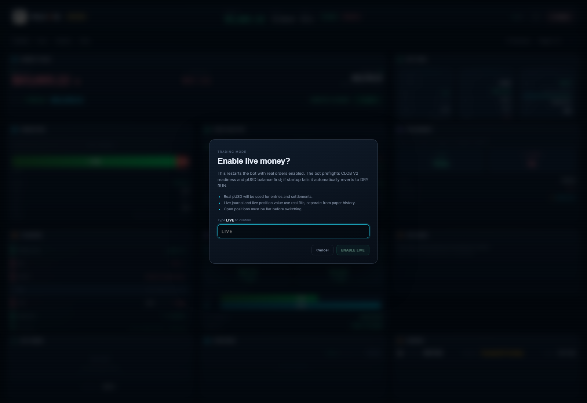

# Live / dry-run switch from the dashboard — 2026-10-21

## UX

- The topbar `DRY RUN` / `LIVE` badge is now a button.
- Clicking it opens a confirmation dialog: the operator must type **LIVE** or **DRY** exactly.
- The button is disabled while the bot is paused or disconnected.
- After confirmation the bot restarts in the new mode (systemd, ~10s); the dashboard reconnects and the badge updates.

## Safety model

- **Live preflight:** before enabling live money the bot initializes CLOB V2, runs the readiness/allowance check, and requires a non-zero pUSD balance. If preflight fails, the mode does not change.
- **Open positions:** switching is refused while a position is open.
- **Automatic fallback:** if live startup later fails (CLOB init, readiness, pUSD bankroll sync), the bot writes `DRY_RUN=true` and exits; systemd restarts it in the safe paper mode. It never loops forever in a failed live mode.
- **Paused bot:** the UI blocks switching while paused; resume first.

## Real-money accounting

Mode paths are separate:

| Data | DRY RUN | LIVE |
|---|---|---|
| state | `state.json` | `state.live.json` |
| audit | `state_audit.jsonl` | `state_audit.live.jsonl` |
| journal | `trade_journal.jsonl` | `trade_journal.live.jsonl` |
| verified journal | `verified_journal.jsonl` | `verified_journal.live.jsonl` |

- On live startup the bankroll is seeded from real pUSD (not the paper bankroll).
- Live state starts clean; journal analytics reads the live journal/audit, so paper trades do not appear in live WR/PnL/equity.
- Position value comes from the live positions/state and uses real fills.
- Switching back to DRY RUN restores the paper state/journal.

## Files/commands

- `src/components/dashboard/DashboardShell.tsx` — badge, modal, confirm.
- `bot/src/trading/tradingMode.ts` — validators, preflight, env atomic write, restart.
- `bot/src/statusServer.ts` — token-protected `setTradingMode` command.
- `bot/index.ts` — live bankroll sync + fail-safe revert.
- `bot/src/config.ts` — mode-specific paths.

## Verification

- UI modal: live dialog, wrong/lowercase phrase disables confirm, `LIVE` enables it; cancel works. (Live was **not** confirmed.)
- `setTradingMode dry DRY` while already dry → `{ok:false,error:"Already in dry-run mode"}`; no restart.
- Live-mode config paths verified: `state.live.json`, `state_audit.live.jsonl`, `trade_journal.live.jsonl`, `verified_journal.live.jsonl`.
- Mode guard tests: unknown mode, wrong phrase, already-active mode — all pass.
- Full suite after the feature: **91 files / 941 tests PASS**.
- Bot remains **DRY RUN**; no live order was placed.

## Remaining live blockers

- pUSD collateral is still far below the paper bankroll; with 5-share minimum many Kelly stakes would be refused.
- JEV remains shadow.
- Do not enable live until the operator accepts these risks and has checked the real wallet balance.